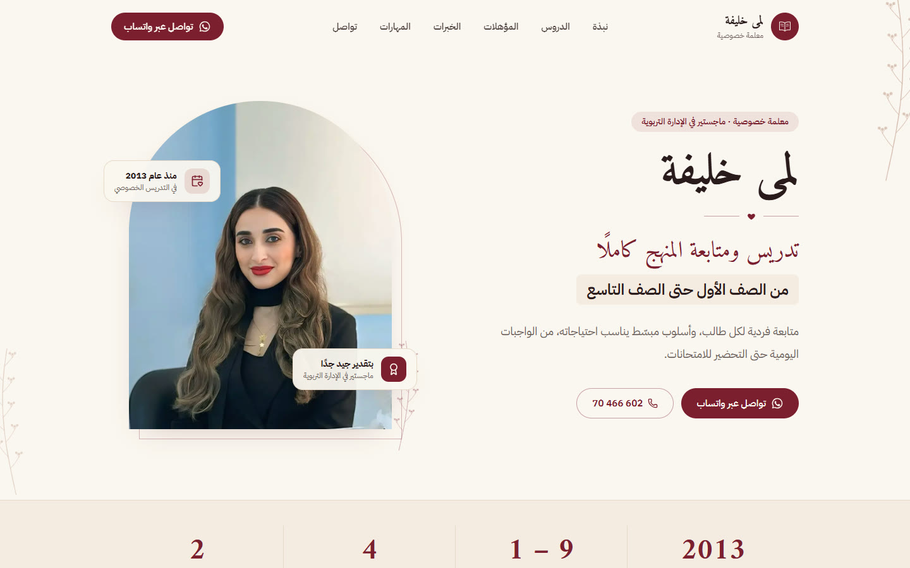
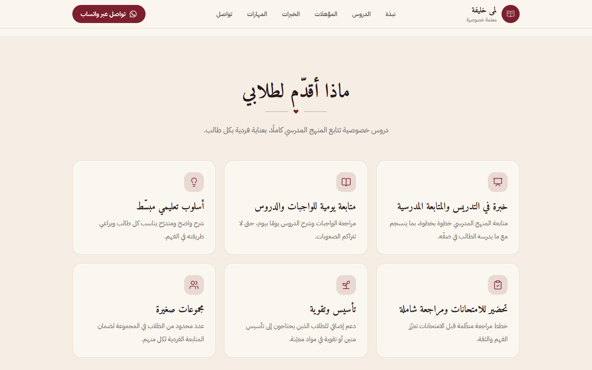
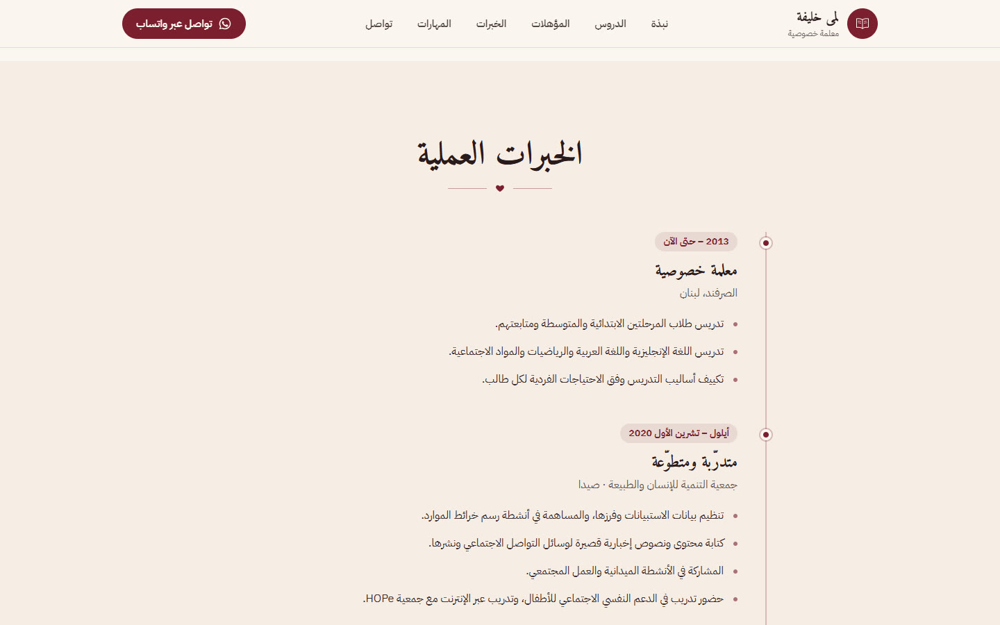
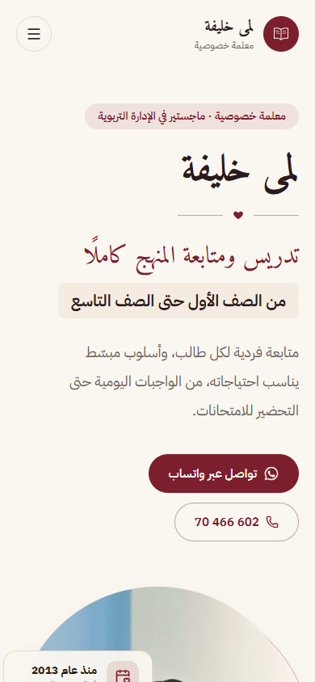

# Lama Khalifeh · Private Tutor Website

**A personal website for a private tutor in Lebanon, in formal Arabic, so parents can see who she is and reach her in one tap.**

## The problem

A private tutor (grades 1 to 9) had her CV, a photo and an Instagram post, but no single place where parents could see her qualifications, what she teaches and how to contact her.

## The solution

A one-page Arabic website, designed from her own colours and style, that answers parents' questions in order: who she is, which lessons she offers, her degrees and experience, and a contact form that opens WhatsApp with the parent's message already written.

## Key features

- **Fully right-to-left Arabic** layout, with numbers, email and phone displayed correctly inside the Arabic text.
- **Her own visual identity:** colours, flowers and book motif taken from her existing post.
- **WhatsApp inquiry form:** parents choose the grade and subject, write a note, and send it straight to WhatsApp. Nothing is stored.
- **Phone-first:** a smooth side menu on phones, keyboard-accessible and easy to close.
- **Gentle scroll animations** that turn off for visitors who prefer less motion.
- **Security headers** that stop other sites from embedding the page and block camera, microphone and location access.

## Screenshots

| Lessons | Experience |
| --- | --- |
|  |  |

## Tech stack

| | |
| --- | --- |
| **Languages** | TypeScript, CSS |
| **Framework** | Next.js 16 (React) |
| **Styling** | Tailwind CSS v4 |
| **Validation** | Zod |
| **Testing** | Vitest |
| **Hosting** | Vercel |

---

> **Source code is private.** For hiring or client review, code access is available on request: DM [@cedarcode.lb](https://instagram.com/cedarcode.lb) or visit [cedarcodesite.com](https://cedarcodesite.com).

© 2026 CedarCode. All rights reserved.
